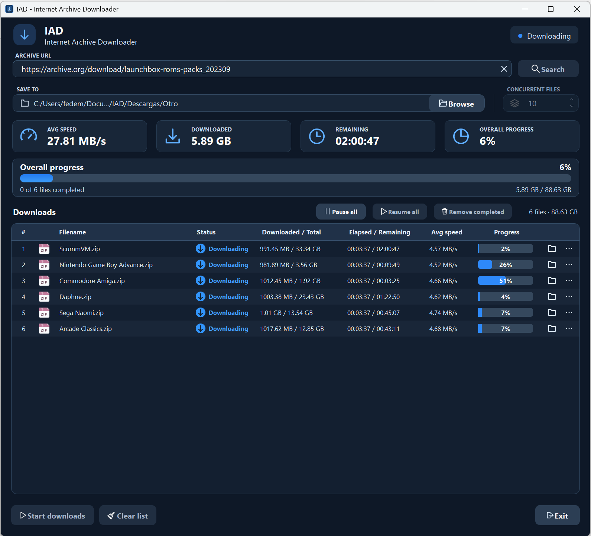

# IAD v2 — Internet Archive Downloader

IAD is a Windows desktop application for downloading files from the [Internet Archive](https://archive.org/). Sign in with your Internet Archive account, choose the files you want, and download them in parallel.



## What's new in v2

- Redesigned sign-in window, file picker, and download dashboard.
- Search and filter files before adding them to the download queue.
- Pause and resume individual files or the entire queue. Downloads resume from saved bytes while IAD stays open.
- Automatically redistribute download workers as files finish or pause, and reuse HTTP connections between fragments.

## Installation on Windows

1. Install 64-bit Python 3. IAD v2 was tested with Python 3.13.
2. Download and extract the [v2.0.0 source ZIP](https://github.com/fedemarkco/IAD-Internet-Archive-Downloader-/archive/refs/tags/v2.0.0.zip).
3. Run `run-IAD.cmd`. On the first launch, it creates a local virtual environment and installs the dependencies from `requirements.txt`.

If you already have a virtual environment, activate it and run these commands from the extracted folder:

```bat
python -m pip install -r requirements.txt
python IAD.py
```

## How to download files

1. Sign in with your Internet Archive account.
2. Open an Internet Archive item, click **Show All** under **Download Options**, and copy the file-listing URL. It should look like `https://archive.org/download/item-identifier`.
3. Paste the URL into **Archive URL** and click **Search**.
4. Select the files you want and click **Add selected**.
5. Choose a destination folder with **Browse**, set **Concurrent files**, and click **Start downloads**.

Right-click a row or use its **…** menu to open the destination folder, copy the filename, or pause or resume that file. Use **Pause all** and **Resume all** to control the entire queue.

Download speeds vary with the connection, the server, and the files in the queue.

## Original version

The original interface and `project.py` are available in [IAD v1.0.0](https://github.com/fedemarkco/IAD-Internet-Archive-Downloader-/tree/v1.0.0).

## Author

Marco Weihmüller

## License

IAD is licensed under the [GNU General Public License v3.0](LICENSE).
