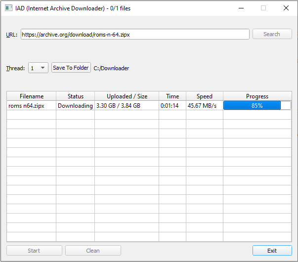

# IAD v1 — Internet Archive Downloader

IAD is a Windows desktop application for downloading files from the [Internet Archive](https://archive.org/). It lets you sign in with your account, select files from an item, and download multiple files in parallel.

The project started as a way to speed up large downloads from Internet Archive. In my tests, IAD exceeded 30 MB/s. Actual speeds vary with the connection, the server, and the files being downloaded.



## Installation

1. Install Python 3 on Windows.
2. Download and extract the source code for `v1.0.0`.
3. Open a terminal in the extracted folder and run:

```bat
python -m pip install -r requirements.txt
python project.py
```

## How to download files

1. Sign in with your Internet Archive account.
2. Open an item on Internet Archive. Under **Download Options**, click **Show All** and copy the URL of the file listing. It should look like `https://archive.org/download/item-identifier`.
3. Paste the URL into IAD and click **Search**.
4. Select the files or folders you want to download and confirm your selection.
5. Click **Save To Folder** and choose a destination.
6. Use **Thread** to choose how many files to download in parallel, up to 32.
7. Click **Start** to begin downloading.

## Versions

This README documents the original IAD interface. For the redesigned Windows application, see [IAD v2 on the main branch](https://github.com/fedemarkco/IAD-Internet-Archive-Downloader-/tree/main).

## Author

Marco Weihmüller

## License

IAD is licensed under the [GNU General Public License v3.0](LICENSE).
